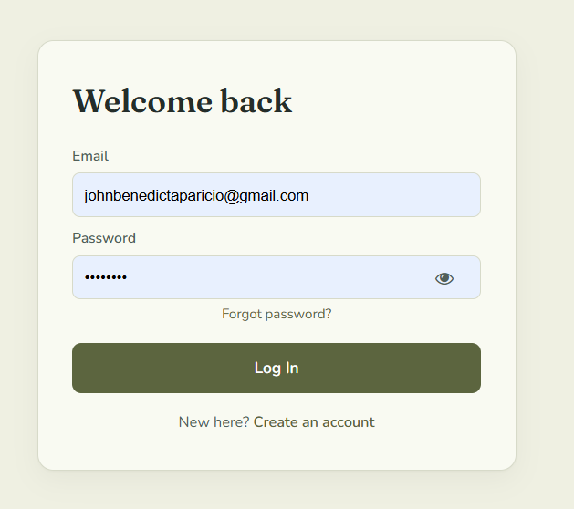
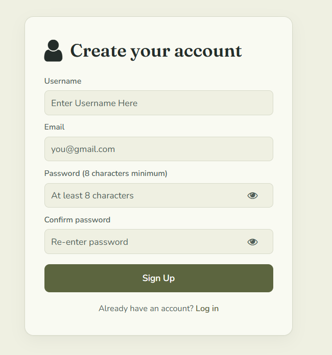
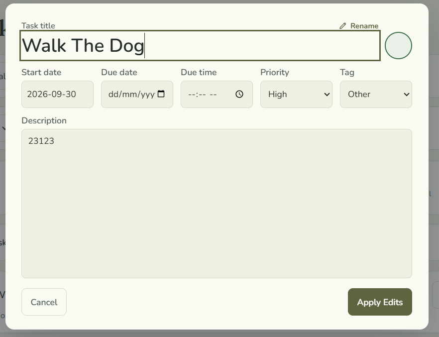
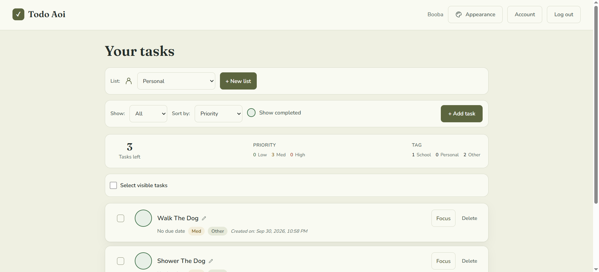
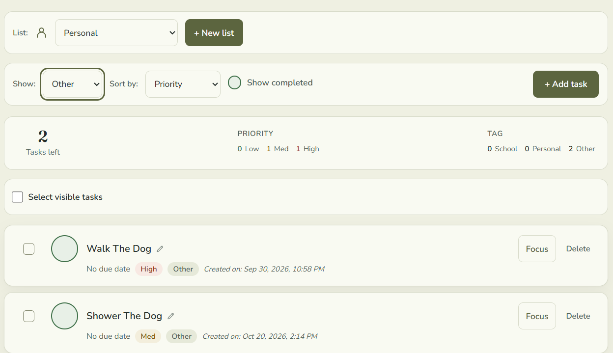
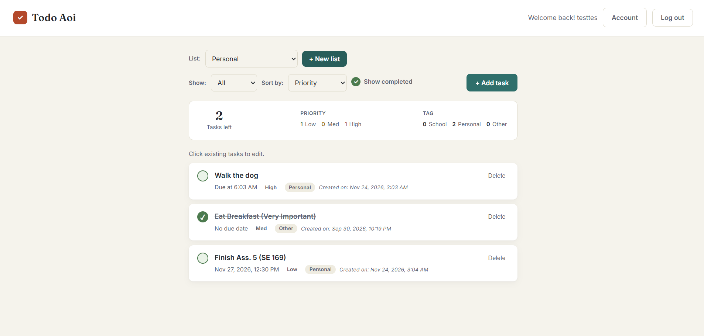
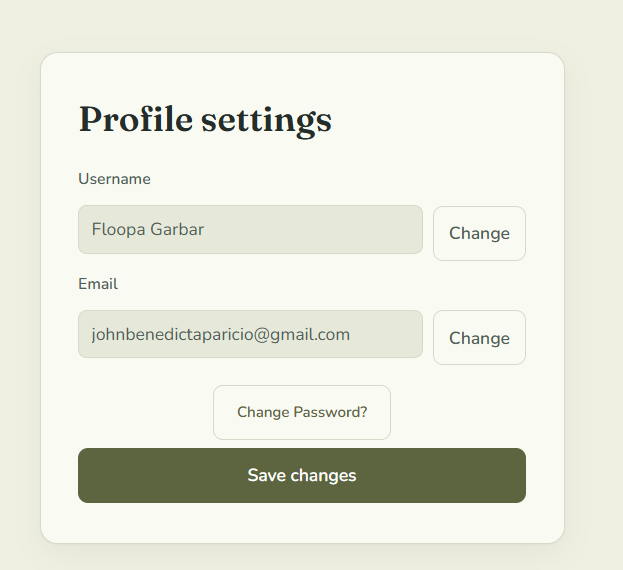
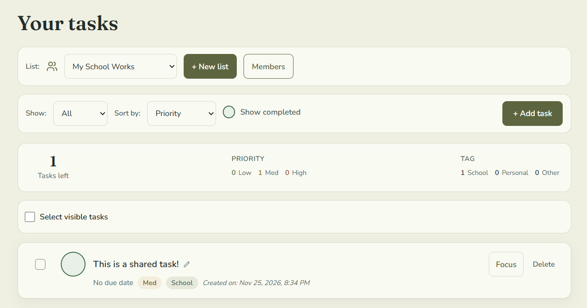

# CMSC128-CRUDToDoList
Repository for a todo list highlighting the features of CRUD in a to do list reminder

1. Tech Stack:
+ Why Javascript, HTML, CSS only?
- A simple app such as a todo list with the given freedom of writing to local storage and the cloud is perfect for a solo javascript implementation of a todo-list because it has its own data format, JSON.
+ Database - Supabase:
- Supabase is a no-brainer because it integrates with js seamlessly with a FREE TIER!
Also, because it has row level security (i.e. only specific actors can access or
change a row in a table) the public key and url doesn't need to be hidden in a .env
which requires node.js

2. API endpoints/Data operations:
- **Read tasks** - Gets all tasks for the signed-in account using `fetch_tasks()` in `db_fetch.js`, so tasks are shared across browsers. The account ID is read from the active Supabase session, not directly from browser-controlled storage. The Supabase request/connection is handled by `db_connection.js`.

- **Create task** - Adds a new task with its title, description, priority, tag, due date, and completion status. The form is handled in `add_task.js`, while the database insert is handled by `insert_task()` in `db_fetch.js`.

- **Update task** - Changes an existing task's details through the edit form in `task_popup.js`. The update request is sent by `update_task()` in `db_fetch.js`, and completing or uncompleting a task is handled in `task_shortview.js`.

- **Delete task** - `delete_task()` in `delete_task.js` asks for confirmation, then provides a 10-second undo window before calling `remove_task()` in `db_fetch.js`. The dashboard also supports selecting visible tasks to complete or delete together.
- **Appearance** - The dashboard's Appearance menu offers five color themes that tint the background and accent in both light and dark mode. Preferences are stored in the browser and shared across the app's pages.

## Activity 4 backend refactor

List initialization fetches the list records without loading each owned list’s member roster. In a mocked comparison with five owned lists, the list picker went from **6 requests to 1** (83% fewer). Opening **Members** still fetches the roster on demand. To verify on a signed-in account, reload with the browser Network tab open and compare the `lists` and `get_list_members` requests.

Task saves capture the destination list at submission. A delayed response stays associated with that list even if you switch lists before it arrives.

## Activity 4 bonus · Task-linked focus timer

Choose **Focus** on any task, set **Duration (min)** to a whole number from 1 to 120 (default 25), and select **Start**. Pause and resume whenever you need. Reset returns the timer to its chosen duration and lets you adjust it before starting again. The sprout grows with the session and blooms at completion. When time runs out, **Need more time?** lets you add 1 to 120 minutes to the same task or finish the timer. An extension keeps your original Reset duration. The timer and completion prompt also work with reduced motion enabled.

For the defense, choose a 1-minute session, start it, pause it, refresh, and resume until the sprout blooms. A running session saves its end time, so refreshing the page or backgrounding the tab does not restart the countdown. A paused session saves its remaining time. The timer is stored per signed-in account in this browser and makes no database requests. Switching to another list closes the focus timer and clears the session.

# Images taken from the website

  <strong>Login Page</strong> 
  

  <strong>Register Page</strong> 
  

  <strong>Task Edit/Add Popup</strong> 
  

  <strong>Populated Page</strong> 
  

  <strong>Filter/Sort</strong> 
  

  <strong>Completed Tasks</strong> 
  

  <strong>Profile Settings</strong> 
  

  <strong>Collaborative Lists</strong> 
  

---

+ How Activity 1 and Activity were merged:
Activity 2 was made by building upon activity 1. Going forwards, the same method was done for the following activities by using the previous activity's branch to make a new branch for the new activity.

# Running locally
#### !!! Be advised that the functions of the app as it is in its current version won't work without an internet connection

+ Without accessing the deployed URL, one can run the app locally in VS Code with the live server extension. Simply open `index.html` and it will redirect you to the current page depending on the status of your session, if there is a logged in account or not. 